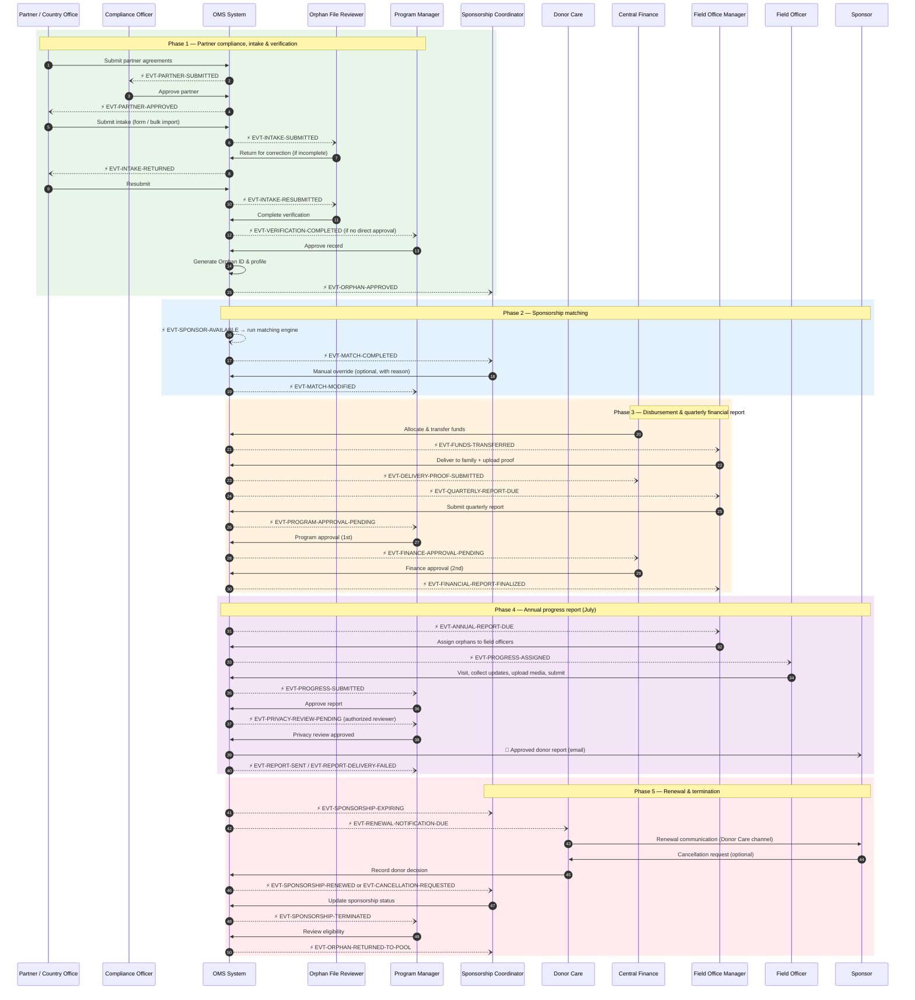
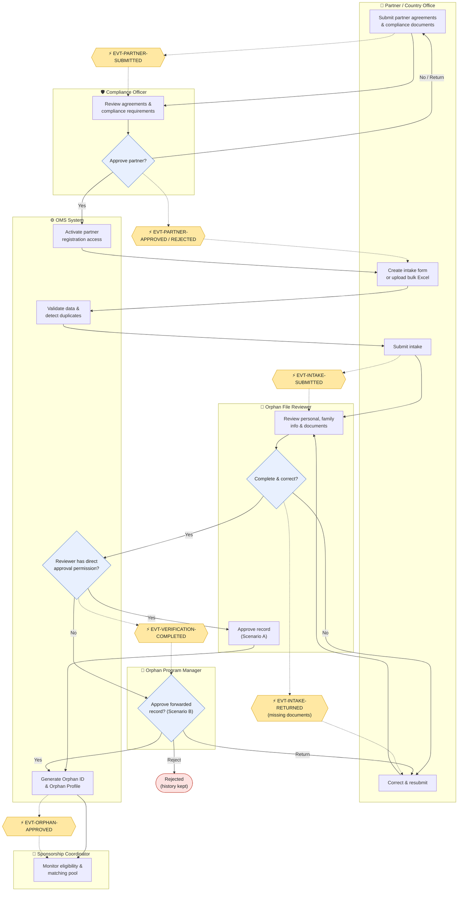
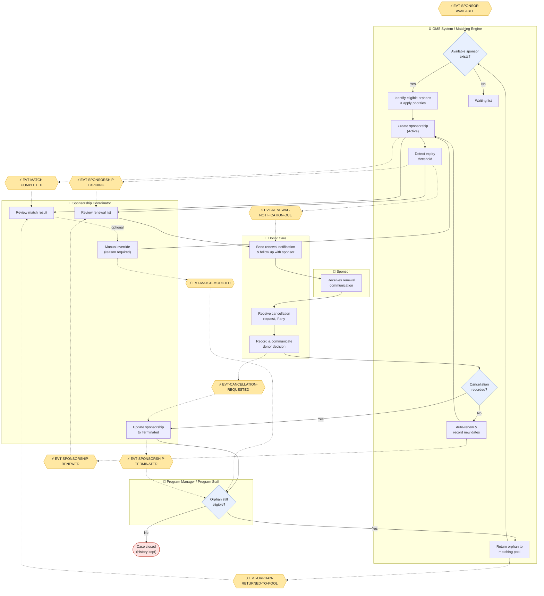
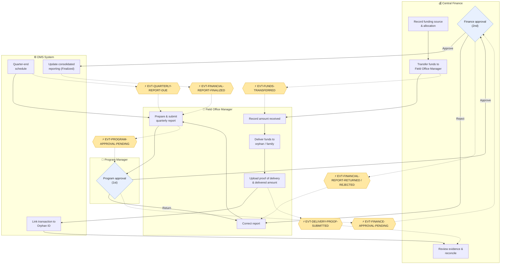
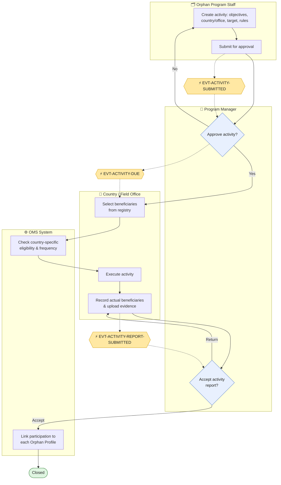
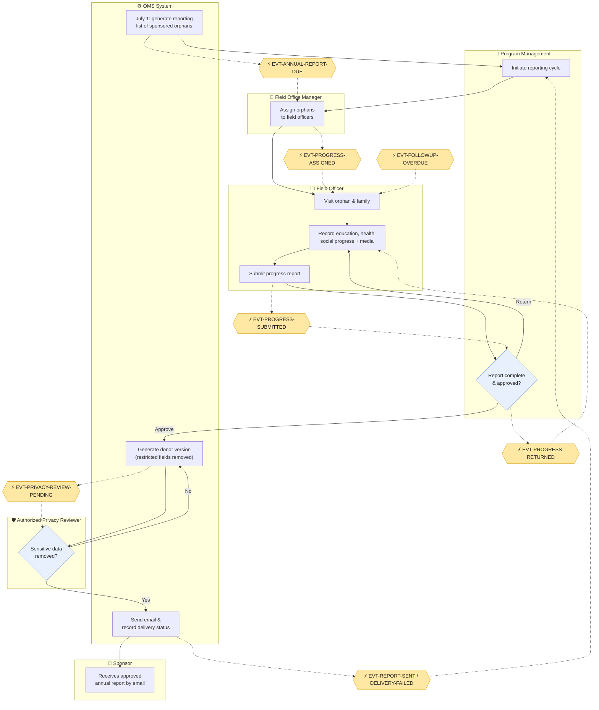

# OMS — Stakeholder Workflows & Notification Events

**Classification:** Confidential — For Recipients and Authorized Parties Only  
**Version:** 1.0  
**Date:** 11.04.2026  
**Status:** Issued for Review  
**Source:** BRD v1.1 §6–§11 · Workflow & Permission Matrix v1.1 Parts 2 & 5

## 1. How to read the diagrams

Each diagram groups steps by **stakeholder lane** (one box per stakeholder). Every hand-over between stakeholders is a **notification event**.

| Shape | Meaning |
|---|---|
| Rectangle | Workflow step performed by the lane's stakeholder |
| Diamond | Decision |
| ⚡ Hexagon (yellow) | Notification event published by the system |
| Rounded red | End / termination |
| Solid arrow `→` | Workflow sequence |
| Dotted arrow `⇢` | Event emitted / event delivered to recipient |

Event names use the format `EVT-<AREA>-<ACTION>`. The full catalogue is in §8.

---

## 2. End-to-end stakeholder event map

The sequence below shows the main lifecycle of one orphan, from partner onboarding to the annual report reaching the sponsor. Each arrow is an event; the arrow's target is the stakeholder who must act.



---

## 3. Partner compliance, intake & verification



**Rules:** only approved partners can submit (BR-002) · bulk import never bypasses verification · returned records keep history · reviewer approval is a configurable permission (W-01).

---

## 4. Sponsorship matching, renewal & termination



**Rules:** no matching without an available sponsor (BR-008) · priority to orphans whose sponsorship ended, then younger orphans · renewal is the default (BR-012) · Donor Care owns all sponsor communication (BR-013) · termination never deletes history (BR-017).

---

## 5. Disbursement & quarterly financial report



**Rules:** transferred ≠ delivered · proof of delivery is mandatory (BR-022) · Program Manager first, Finance second, both mandatory (BR-019, BR-020) · a Field Office Manager cannot approve their own report.

---

## 6. General support activity



---

## 7. Annual progress report & donor email (July cycle)



**Rules:** mandatory for every sponsored orphan (BR-024) · cycle starts in July (BR-025) · only approved, privacy-reviewed content is sent (BR-028) · Donor Care handles any donor follow-up about the report.

---

## 8. Notification event catalogue

| Event code | Trigger | Published by | Recipient(s) | Required action | Channel |
|---|---|---|---|---|---|
| EVT-PARTNER-SUBMITTED | Partner submits compliance documents | System | Compliance Officer | Review agreements | In-app, Email |
| EVT-PARTNER-APPROVED | Compliance approves partner | Compliance Officer | Partner User, Country Office Manager | Start intake | In-app, Email |
| EVT-PARTNER-REJECTED | Compliance rejects / returns | Compliance Officer | Partner User | Correct documents | In-app, Email |
| EVT-PARTNER-AGREEMENT-EXPIRED | Agreement end date reached | Scheduler | Compliance Officer, Partner User, Country Office Manager | Renew agreement | In-app, Email |
| EVT-BULK-IMPORT-VALIDATED | Excel validated | System | Uploader | Review errors & duplicates, confirm | In-app |
| EVT-INTAKE-SUBMITTED | Intake submitted | System | Orphan File Reviewer | Review application | In-app |
| EVT-INTAKE-RETURNED | Verification incomplete / missing documents | Reviewer | Partner / Country Office | Upload missing documents | In-app, Email |
| EVT-INTAKE-RESUBMITTED | Corrections submitted | System | Orphan File Reviewer | Re-review | In-app |
| EVT-VERIFICATION-COMPLETED | Reviewer finishes verification | System | Reviewer / Program Manager | Approve according to permissions | In-app |
| EVT-ORPHAN-APPROVED | Record approved, Orphan ID generated | System | Sponsorship Coordinator, submitter | Monitor eligibility | In-app |
| EVT-ORPHAN-REJECTED | Record rejected | Reviewer / PM | Submitter | Note decision | In-app |
| EVT-SPONSOR-AVAILABLE | Sponsor capacity becomes available | System | Matching Engine, Sponsorship Coordinator | Run matching | System, In-app |
| EVT-MATCH-COMPLETED | Assignment created (new sponsorship) | Matching Engine | Sponsorship Coordinator | Monitor assignment | In-app |
| EVT-MATCH-MODIFIED | Manual override | Sponsorship Coordinator | Relevant program staff | Review audit history | In-app |
| EVT-SPONSORSHIP-EXPIRING | Configured expiry threshold (P-03) | Scheduler | Orphan Management (SC), Donor Care | Renewal preparation | In-app, Email |
| EVT-RENEWAL-NOTIFICATION-DUE | Expiration approaching | Scheduler | Donor Care | Contact sponsor | In-app, Email |
| EVT-CANCELLATION-REQUESTED | Donor Care records cancellation | Donor Care | Sponsorship Coordinator | Update sponsorship | In-app |
| EVT-SPONSORSHIP-RENEWED | No cancellation by end date / renewal confirmed | System | Sponsorship Coordinator, Donor Care | Note new dates | In-app |
| EVT-SPONSORSHIP-TERMINATED | Cancellation confirmed | Sponsorship Coordinator | Orphan Program Staff | Recheck eligibility | In-app |
| EVT-ORPHAN-RETURNED-TO-POOL | Eligible orphan re-pooled | System | Sponsorship Coordinator | Monitor re-matching | In-app |
| EVT-ACTIVITY-SUBMITTED | Activity submitted for approval | Program Staff | Program Manager | Approve activity | In-app |
| EVT-ACTIVITY-DUE | Activity approved / scheduled | System | Country / Field Office | Select beneficiaries & execute | In-app, Email |
| EVT-ACTIVITY-REPORT-SUBMITTED | Activity evidence submitted | Field Office | Program Manager | Review report | In-app |
| EVT-FUNDS-TRANSFERRED | Transfer recorded | Central Finance | Field Office Manager | Confirm receipt, deliver | In-app, Email |
| EVT-DELIVERY-PROOF-SUBMITTED | Proof uploaded | Field Office Manager | Finance / Program Staff | Review evidence | In-app |
| EVT-QUARTERLY-REPORT-DUE | Quarter-end schedule (P-05) | Scheduler | Field Office Manager | Submit report | In-app, Email |
| EVT-PROGRAM-APPROVAL-PENDING | Quarterly report submitted | System | Program Manager | Review report | In-app |
| EVT-FINANCE-APPROVAL-PENDING | Program approval completed | System | Central Finance | Financial review | In-app |
| EVT-FINANCIAL-REPORT-RETURNED | Program Manager returns | Program Manager | Field Office Manager | Correct report | In-app, Email |
| EVT-FINANCIAL-REPORT-REJECTED | Finance rejects | Central Finance | Field Office Manager, Program Manager | Correct report | In-app, Email |
| EVT-FINANCIAL-REPORT-FINALIZED | Both approvals complete | System | Field Office Manager, Program Manager | — | In-app |
| EVT-ANNUAL-REPORT-DUE | July reporting cycle | Scheduler | Field Office Manager | Collect progress data | In-app, Email |
| EVT-PROGRESS-ASSIGNED | Orphan assigned to field officer | Field Office Manager | Field Officer | Visit & collect data | In-app |
| EVT-PROGRESS-SUBMITTED | Progress report submitted | Field Officer | Program Manager | Review & approve | In-app |
| EVT-PROGRESS-RETURNED | Report returned | Program staff | Field Officer | Correct report | In-app |
| EVT-PRIVACY-REVIEW-PENDING | Report approved, donor version ready | System | Authorized privacy reviewer | Check information | In-app |
| EVT-REPORT-SENT | Email delivery attempted | System | Orphan Management | Monitor delivery status | In-app |
| EVT-REPORT-DELIVERY-FAILED | Email bounced / failed | System | Orphan Management | Retry / correct address via Donor Care | In-app |
| EVT-FOLLOWUP-OVERDUE | Next follow-up date passed | Scheduler | Field Officer, Field Office Manager | Conduct visit | In-app, Email |

## 9. Event payload (standard)

```json
{
  "eventCode": "EVT-INTAKE-SUBMITTED",
  "occurredAt": "2026-11-04T09:30:00Z",
  "actor": { "userId": "uuid", "role": "PARTNER_USER" },
  "record": { "type": "INTAKE", "id": "uuid", "status": "SUBMITTED" },
  "scope": { "countryCode": "EG", "officeId": "uuid", "partnerId": "uuid" },
  "recipients": [{ "role": "ORPHAN_FILE_REVIEWER" }],
  "link": "/intakes/uuid"
}
```

- Recipients are resolved by role **and** scope (country, office, assigned records).
- Payloads sent to Donor Care never contain orphan case data.
- Every event is also written to the audit log.
- Thresholds and recipients are configurable in Notification Rules (Workflow Matrix Part 8).
